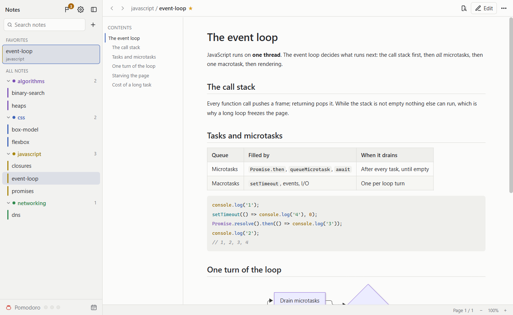
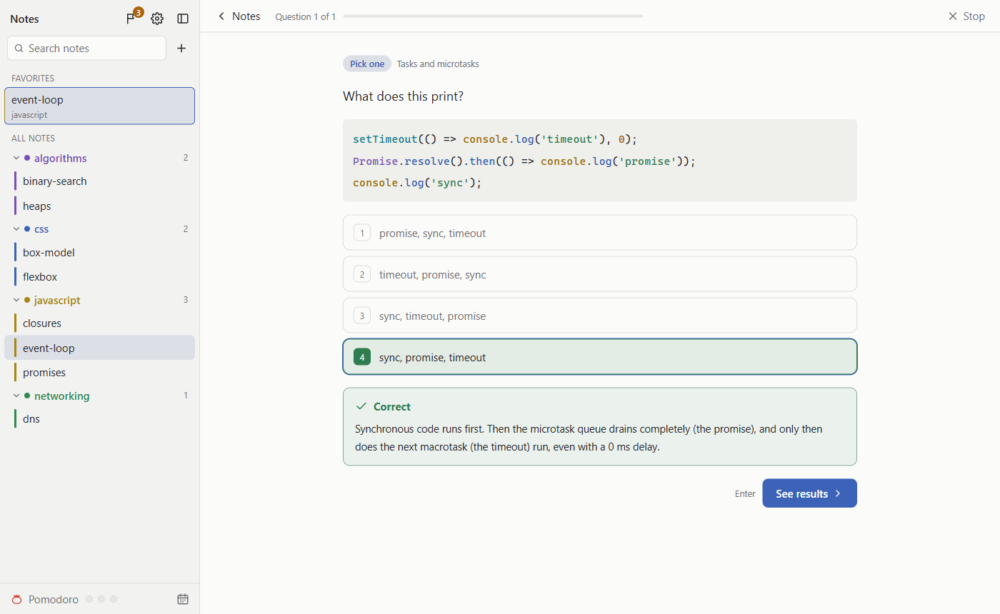
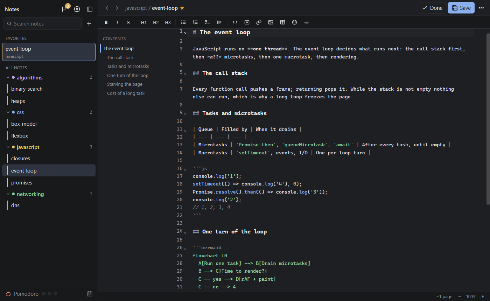

# Cram

[](https://github.com/Levan-D/cram/actions/workflows/test.yml)

A desktop app for studying from your own markdown notes. Point it at a folder of `.md` files and you get a clean reader, a lossless editor, full-text search, quizzes generated from your notes, a Pomodoro timer and a study heatmap. Windows, built with Electron, React and TypeScript.



## Features

- **Read and edit in place.** Rendered markdown with syntax highlighting, KaTeX math and Mermaid diagrams. Switching to the editor (CodeMirror) keeps you on the same paragraph, and saving never reformats your file.
- **Quizzes from your notes.** *Create quiz* copies a prompt for any AI chat (ChatGPT, Claude, Gemini…). Paste the reply back and the app validates it, shows problems by line, and saves it. Four question types, rewordings so repeat quizzes stay fresh, "weak spots first" from your past results. When a note changes, *Update quiz* regenerates only the sections that changed.
- **Search everything.** Ranked full-text search with prefix matching and typo tolerance, highlighted in the note when you open a result.
- **Study tools.** Pomodoro with daily sessions, a GitHub-style activity heatmap, and an *Unresolved* list of every `???`, `idk` or `todo` you left in your notes.
- **Safe by design.** All file access lives in the main process. Writes are atomic, conflicts with outside edits are detected, overwrites are confirmed, and deletes go to the Recycle Bin.
- **Comfortable.** Light and dark themes, works down to a 320px-wide window, keyboard-first, export to PDF.

| Quiz | Editor (dark theme) |
| --- | --- |
|  |  |

The [user guide](docs/guide.md) covers every feature, the safety rules and the keyboard shortcuts.

## Install

Windows 10/11, 64-bit. Build it from source (see [Development](#development)): `npm run dist` puts two files in `dist/`:

- **`Cram-<version>-setup.exe`**: installs for your user (no admin), adds Start menu and desktop shortcuts, and uninstalls from *Settings → Apps*.
- **`Cram-<version>-portable.exe`**: one file, nothing installed. It starts slower because it unpacks itself on every launch.

The builds aren't code-signed, so if you copy one to another PC, Windows SmartScreen will warn the first time. Click **More info → Run anyway**.

## Tech

- **Electron 44** main process in plain JS: file access, markdown rendering (marked, highlight.js, KaTeX), atomic writes, a file watcher. The renderer is sandboxed and talks to it through a small typed IPC API (`preload.cjs` ↔ `src/api.ts`).
- **React 19 + TypeScript (strict)** renderer, **zustand** for state, **CodeMirror 6** for editing, plain CSS with design tokens. Bundled with **esbuild**.
- **Tests:** about 120 unit and component tests (Vitest, React Testing Library) and 20 end-to-end tests (Playwright driving the real Electron app on temp folders).
- **Why CodeMirror and not a WYSIWYG editor:** WYSIWYG editors like TipTap convert markdown into their own model and back, so every save reformats the file and pollutes `git diff`. CodeMirror edits the text itself, so a save changes only what you changed.

## Development

Requires Node 24.

```bash
npm install
npm start            # build the renderer and run the app
npm test             # unit + component tests
npm run test:e2e     # end-to-end tests against the real app
npm run dist         # typecheck, test, then build the installer and portable exe into dist/
```

If your npm blocks install scripts, Electron's binary won't download: run `node node_modules/electron/install.js` once.

Project layout: `main.js` is the main process, `src/` the React app (`ui/` components, `lib/` framework-free logic), `quiz-format.js` / `quiz-gen.js` the quiz file format and generation, `test/` and `e2e/` the tests. More in [docs/development.md](docs/development.md); the quiz file format is in [docs/quiz-format.md](docs/quiz-format.md).
